# CRM-123 · Manual de usuario

**Versión 1.0 · 18/11/2026**
**Para:** vendedores y supervisores del equipo comercial de pólizas de seguros
**Moneda:** pesos mexicanos (MXN) · **Zona horaria:** Ciudad de México

> **Sobre las imágenes.** Provienen del diseño aprobado y muestran datos de ejemplo. Tres diferencias con la versión construida: no hay buscador en la barra superior (se busca dentro de **Clientes**), la etapa de una oportunidad se cambia con el botón **Etapa** (no se arrastra) y el diseño del comparativo no se incluyó.

---

## Resumen ejecutivo

CRM-123 es un CRM sencillo para un equipo comercial pequeño: **10 vendedores y 2 supervisores**. Reúne en un solo lugar a los clientes, las oportunidades de venta, las pólizas, la cobranza, los siniestros y las comisiones.

| | |
|---|---|
| **Qué resuelve** | Que cada vendedor sepa qué hacer hoy y que el supervisor vea el estado del equipo sin pedir reportes. |
| **Dos aplicaciones** | **Web de escritorio** para el trabajo diario. **PWA** (aplicación instalable en el celular) para que el supervisor consulte rápido. |
| **Dos perfiles** | **Vendedor** (ve y gestiona solo lo suyo) y **Supervisor** (ve todo, administra y reasigna). |
| **Automatización** | Un resumen por correo, de lunes a viernes a las 7:30 a. m., para cada vendedor y supervisor. |
| **Principio de seguridad** | Nada se borra: se archiva, se desactiva o se cancela. Cada acción importante queda en un historial que nadie puede editar. |

## Contenido

1. [Cómo entrar](#1-cómo-entrar)
2. [Perfiles y permisos](#2-perfiles-y-permisos)
3. [Aplicación de escritorio](#3-aplicación-de-escritorio)
4. [Administración (solo Supervisor)](#4-administración-solo-supervisor)
5. [PWA del supervisor](#5-pwa-del-supervisor)
6. [El resumen matutino por correo](#6-el-resumen-matutino-por-correo)
7. [Reglas que conviene conocer](#7-reglas-que-conviene-conocer)
8. [Limitantes](#8-limitantes)
9. [Mensajes frecuentes y qué hacer](#9-mensajes-frecuentes-y-qué-hacer)
10. [Glosario](#10-glosario)

---

## 1. Cómo entrar

| | |
|---|---|
| **Escritorio** | `https://crm-123-web.vercel.app` |
| **PWA (supervisores)** | `https://crm-123-pwa.vercel.app` |

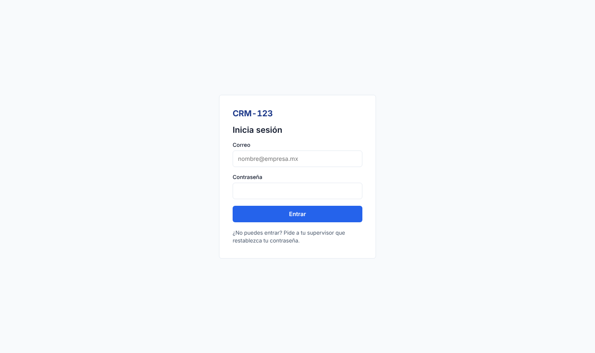

1. Escribe tu **correo** y tu **contraseña**, y pulsa **Entrar**.
2. En tu **primer ingreso**, y cada vez que el supervisor te restablezca la contraseña, el sistema te pide crear una propia. Debe tener **al menos 10 caracteres**.
3. Si no puedes entrar, pide a tu supervisor que te **restablezca la contraseña**. No existe el registro por cuenta propia.

> Por seguridad, el sistema nunca dice si falló el correo o la contraseña. Solo muestra "Correo o contraseña incorrectos".

## 2. Perfiles y permisos

| Pantalla | Vendedor | Supervisor |
|---|---|---|
| Tablero, Clientes, Oportunidades, Pólizas, Cobranza, Siniestros | Solo lo suyo | Todo el equipo, con filtro por responsable |
| Comisiones | Solo las suyas, en lectura | Todas; las liquida |
| Reasignar clientes | No | Sí |
| Administración (usuarios, catálogos, porcentajes, metas, historial) | No aparece | Sí |
| PWA | Solo ve el aviso "Solo para supervisores" | Todas las pantallas |

Las opciones que tu perfil no puede usar **no se muestran**.

---

## 3. Aplicación de escritorio

La barra azul de la izquierda lleva a cada sección. Arriba a la derecha están tu nombre, **Cambiar contraseña** y **Salir**.

### 3.1 Tablero del día: tu punto de partida

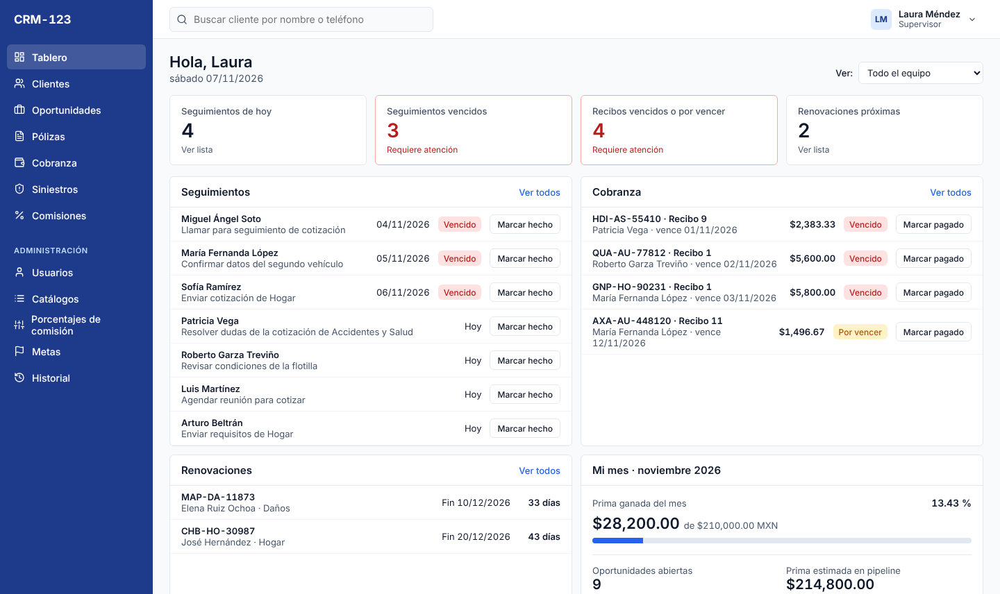

El tablero responde a una pregunta: **¿qué tengo que hacer hoy?**

| Elemento | Qué muestra |
|---|---|
| **Cuatro contadores** | Seguimientos de hoy, seguimientos vencidos, recibos vencidos o por vencer y renovaciones próximas. En rojo, lo que requiere atención. |
| **Seguimientos** | Tus pendientes, con los vencidos primero. Se cierran con **Marcar hecho**. |
| **Cobranza** | Recibos vencidos o por vencer. Se cierran con **Marcar pagado**. |
| **Renovaciones** | Pólizas que terminan su vigencia en los próximos 60 días. |
| **Mi mes** | Prima ganada del mes frente a tu meta, oportunidades abiertas y prima estimada en el pipeline. Si no hay meta, dice "Sin meta asignada este mes". |

El supervisor puede elegir **Ver: Todo el equipo** o un vendedor.

### 3.2 Clientes

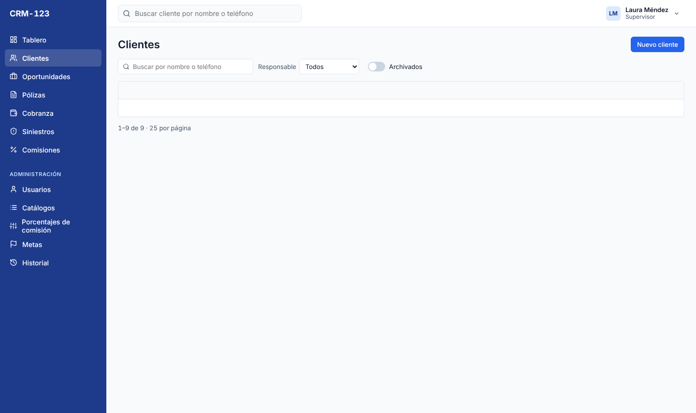

- **Nuevo cliente**: nombre completo y teléfono son obligatorios. El **teléfono de 10 dígitos identifica al cliente**: no se piden RFC, CURP ni otros identificadores personales.
- Se puede escribir `55 1234 5678`: el sistema lo guarda como `5512345678`.
- Si el teléfono ya existe, el sistema avisa: "Ya existe un cliente con ese teléfono. Consulta con tu supervisor."
- El interruptor **Archivados** muestra los clientes archivados.

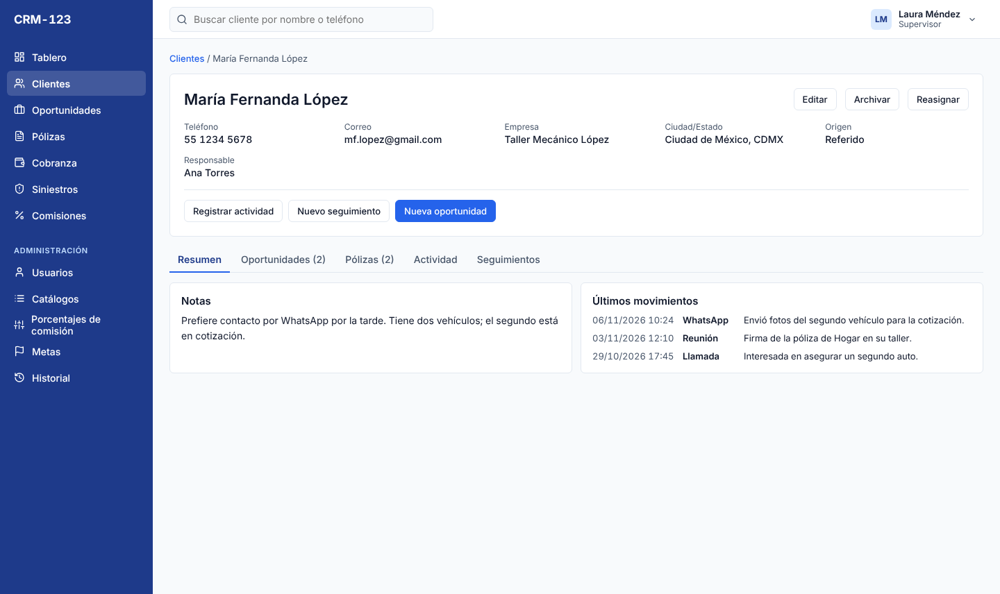

La **ficha** reúne todo del cliente en pestañas: **Resumen**, **Actividad**, **Seguimientos**, **Oportunidades** y **Pólizas**. Desde ahí:

| Acción | Para qué |
|---|---|
| **Registrar actividad** | Anotar una llamada, WhatsApp, correo, reunión o nota. El historial de actividad **no se edita**. |
| **Nuevo seguimiento** | Programar un pendiente con fecha. Aparece en el tablero ese día. |
| **Nueva oportunidad** | Abrir una venta potencial. |
| **Editar** / **Archivar** | Corregir datos o retirar al cliente de las listas. No se borra. |
| **Reasignar** (supervisor) | Pasar el cliente a otro vendedor (ver §7). |

### 3.3 Oportunidades

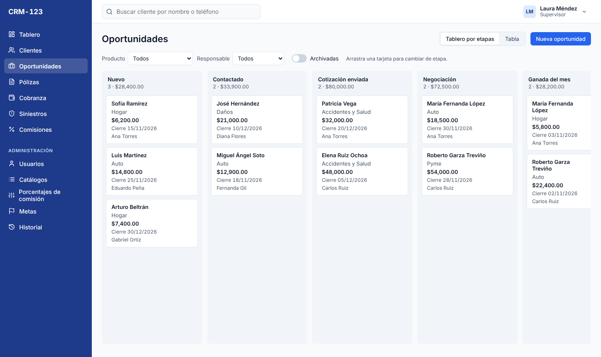

Una oportunidad es una venta en curso. Avanza por las etapas **Nuevo → Contactado → Cotización enviada → Negociación** y termina en **Ganada** o **Perdida**.

- Hay dos vistas: **Tablero** (columnas por etapa, con número y prima estimada) y **Tabla**.
- Para mover una oportunidad, pulsa **Etapa**.
- Al marcarla **Perdida**, el **motivo es obligatorio**.
- Al marcarla **Ganada**, se abre de inmediato **Emitir póliza**.
- Una oportunidad cerrada no se reabre.

### 3.4 Emitir una póliza

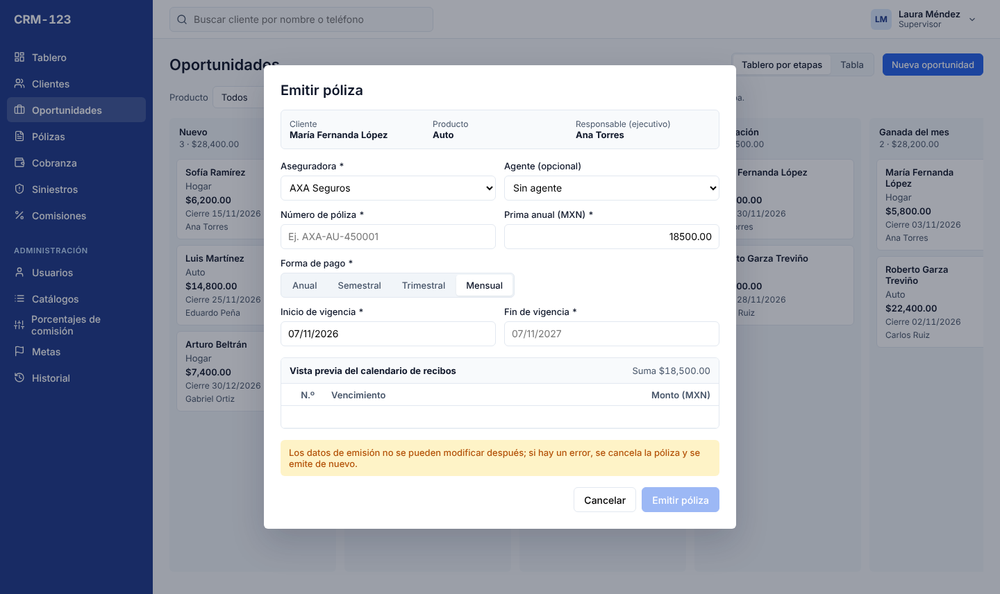

| Campo | Notas |
|---|---|
| Cliente, producto, responsable | Vienen de la oportunidad. Solo lectura. |
| **Aseguradora** | Obligatoria. Se elige de la lista. |
| **Agente** | Opcional. |
| **Número de póliza** | Obligatorio. |
| **Prima anual (MXN)** | Obligatoria. |
| **Forma de pago** | Anual, Semestral, Trimestral o Mensual. |
| **Inicio y fin de vigencia** | Obligatorios. |

Antes de confirmar se ve la **vista previa del calendario de recibos** (número, vencimiento y monto).

> **Atención:** los datos de emisión **no se pueden modificar después**. Si hay un error, se cancela la póliza y se emite de nuevo.

### 3.5 Pólizas y su detalle

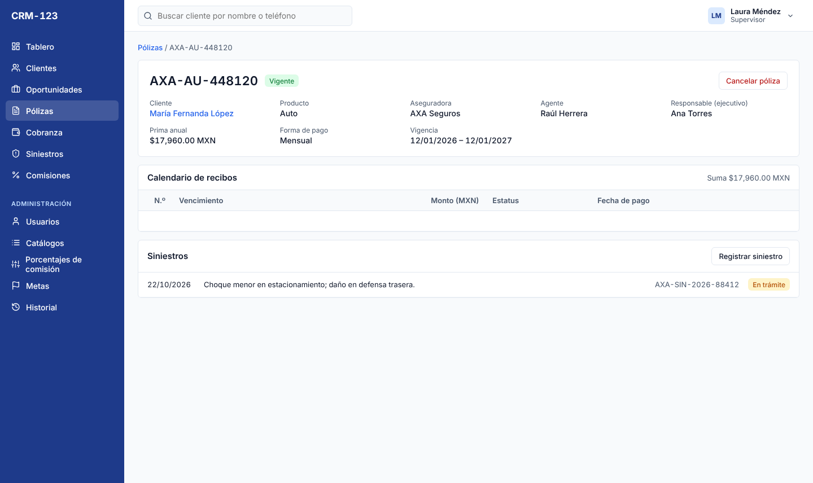

- La lista permite filtrar por estatus (**Emitida, Vigente, Vencida, Cancelada**), producto, aseguradora y pólizas que vencen en 60 días.
- En el detalle están el **calendario de recibos**, con **Marcar pagado** por fila, y los **siniestros** de esa póliza.
- **Cancelar póliza** pide un **motivo**. Se cancelan los recibos pendientes; los recibos pagados y las comisiones ya generadas se conservan.

### 3.6 Cobranza

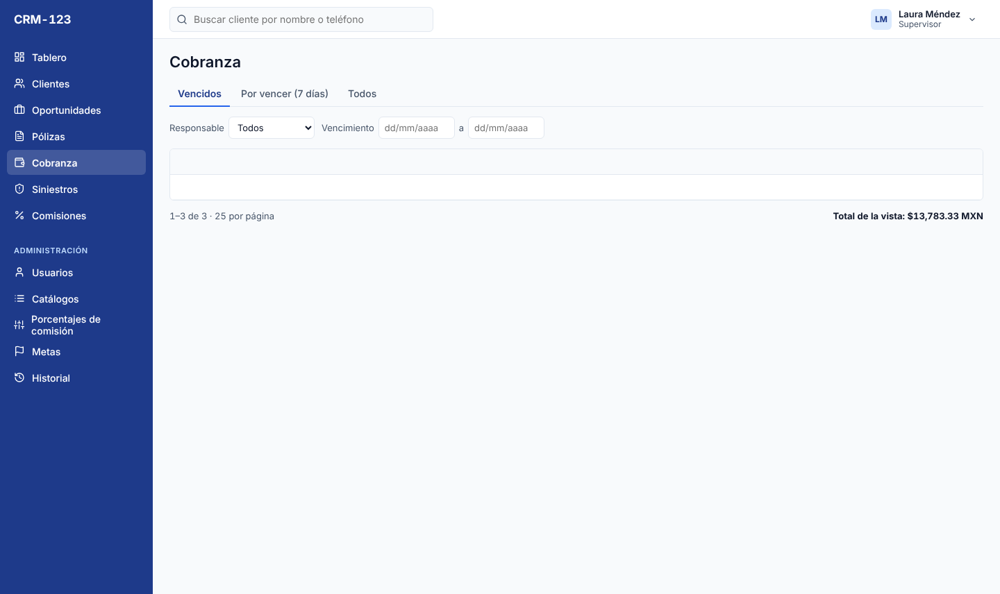

Pestañas **Vencidos**, **Por vencer (7 días)** y **Todos**. En cada fila, **Marcar pagado** pide la fecha de pago (hoy por defecto). Al marcar pagado, la póliza pasa de **Emitida** a **Vigente** y se generan las comisiones correspondientes. Al pie se ve el total de la vista.

### 3.7 Siniestros

Se registran desde el detalle de la póliza o desde **Siniestros**: póliza, fecha del evento, descripción y, si existe, el número de siniestro de la aseguradora. El estatus avanza entre **Reportado, En trámite, Pagado, Rechazado y Cerrado**. Por defecto se ven los abiertos.

### 3.8 Comisiones

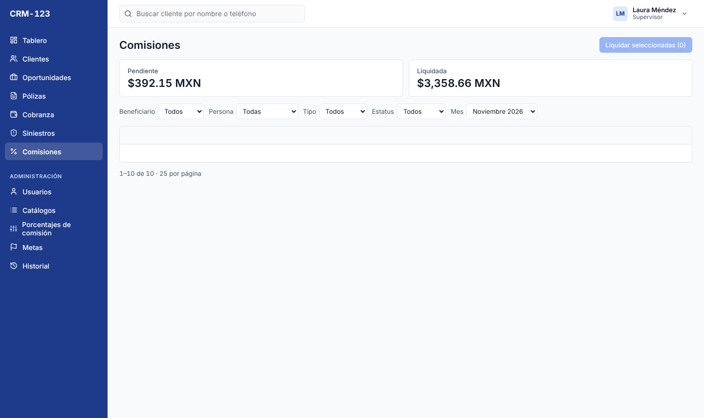

| Perfil | Qué ve y qué puede hacer |
|---|---|
| **Vendedor** | Solo sus comisiones como ejecutivo, en lectura. Arriba ve cuánto tiene **Pendiente por liquidar** y **Liquidado** en el mes. |
| **Supervisor** | Todas, con filtros por beneficiario (ejecutivo o agente), persona, tipo, estatus y mes. Puede **Liquidar** una o varias. La liquidación **no se puede deshacer**. |

Hay comisiones de **Venta** y de **Cobranza**. Se calculan con los porcentajes vigentes cuando se emitió la póliza.

---

## 4. Administración (solo Supervisor)

| Sección | Para qué sirve |
|---|---|
| **Usuarios** | Crear usuarios, editarlos, **restablecer contraseña** y **Desactivar o Reactivar**. Al crear o restablecer, la **contraseña temporal se muestra una sola vez**: cópiala y compártela de forma segura. Un contador indica los cupos: vendedores activos de 10 y supervisores activos de 2. |
| **Catálogos** | Productos, aseguradoras y agentes. Lo desactivado deja de ofrecerse en formularios nuevos. |
| **Porcentajes de comisión** | Una fila por producto con cuatro porcentajes: Venta y Cobranza, para Agente y Ejecutivo. Los cambios aplican solo a las pólizas **nuevas**. |
| **Metas** | La meta mensual de prima (MXN) de cada vendedor, con el avance del mes. |
| **Historial** | Registro de lo que ocurre en el sistema: altas, cambios, reasignaciones y envíos del resumen. Solo lectura. |

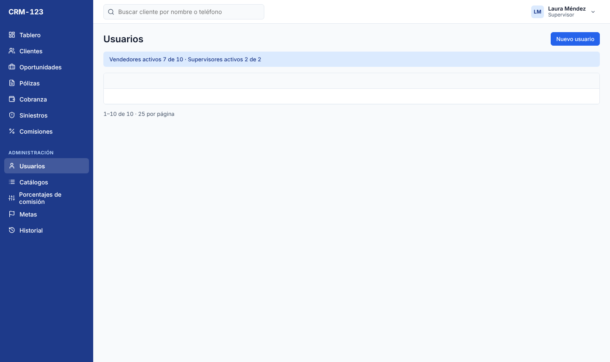

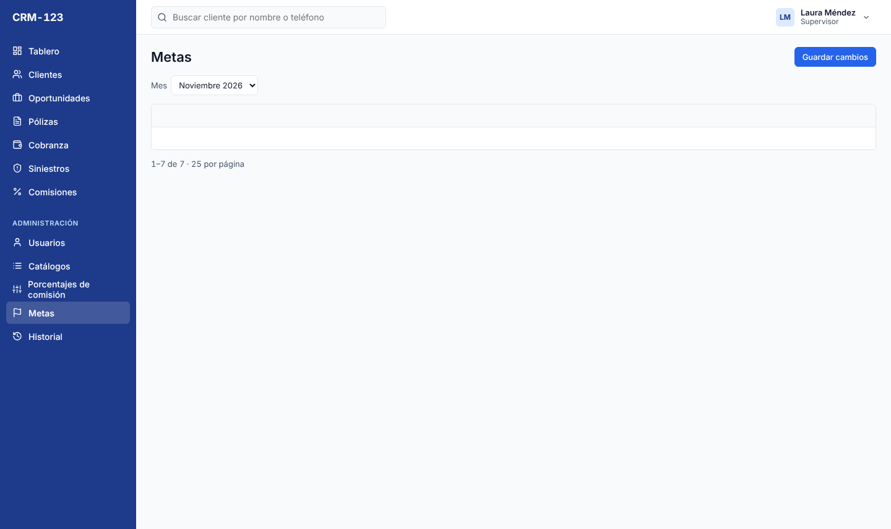

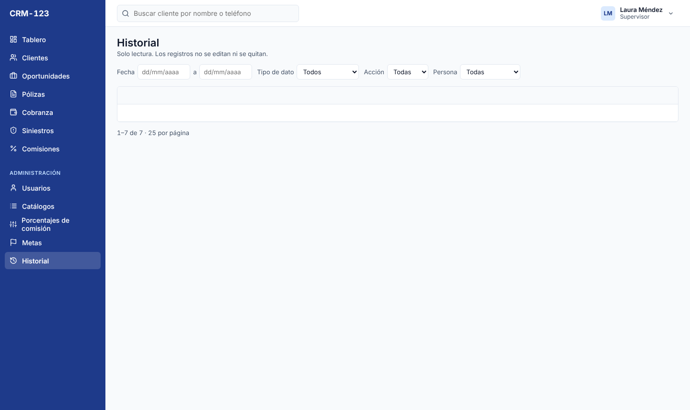

El historial se puede filtrar por fecha, tipo de dato, acción y persona. **Ver detalle** muestra cómo estaba el dato antes y después de cada cambio.

---

## 5. PWA del supervisor

La PWA se usa en el celular, con navegación inferior: **Panel**, **Buscar**, **Resumen** y **Cuenta**.

**Instalarla:** abre la dirección en el navegador del celular y pulsa **Instalar aplicación** (o "Agregar a pantalla de inicio"). Queda con el nombre CRM-123. Sin internet muestra una pantalla de "Sin conexión" con el botón **Reintentar**.

### 5.1 Panel

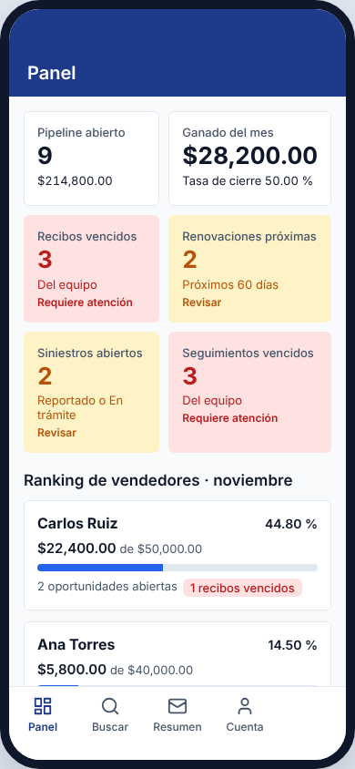

Seis indicadores del equipo (pipeline abierto, ganado del mes y tasa de cierre, recibos vencidos, renovaciones próximas, siniestros abiertos y seguimientos vencidos) y el **ranking de vendedores** del mes, con prima ganada frente a su meta. Toca un vendedor para ver su detalle.

### 5.2 Detalle de vendedor

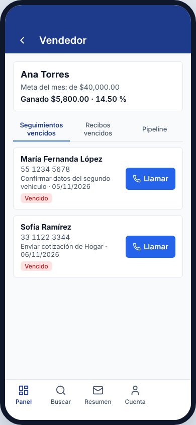

Meta del mes y tres pestañas: **Seguimientos vencidos**, **Recibos vencidos** y **Pipeline**. Cada elemento muestra al cliente y su teléfono con el botón **Llamar**.

### 5.3 Buscar y reasignar

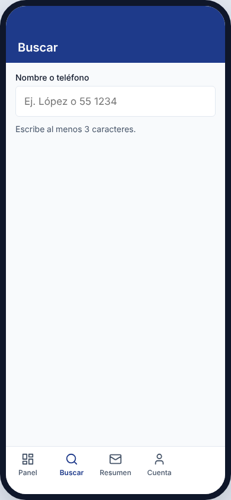

Escribe al menos 3 caracteres del nombre o el teléfono. Toca al cliente y pulsa **Reasignar** para elegir al nuevo responsable.

### 5.4 Resumen matutino

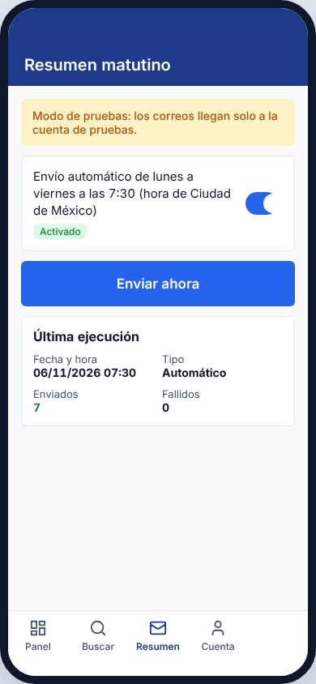

Aquí se controla el envío del correo diario (ver §6).

---

## 6. El resumen matutino por correo

| | |
|---|---|
| **Cuándo** | De lunes a viernes a las **7:30 a. m.** (hora de Ciudad de México), si el interruptor está **Activado**. |
| **Quién lo recibe** | Cada vendedor activo y cada supervisor activo. |
| **Contenido para el vendedor** | Sus seguimientos, recibos y renovaciones pendientes, o "Sin pendientes hoy". |
| **Contenido para el supervisor** | El resumen del equipo: pipeline, ganado del mes, vencidos, renovaciones, siniestros y ranking. |

**Desde la PWA (Resumen), el supervisor puede:**

1. **Activar o pausar** el envío automático con el interruptor.
2. Pulsar **Enviar ahora** y confirmar. El botón muestra **Enviando resumen…** y, al terminar, **Última ejecución** indica cuántos se enviaron y cuántos fallaron.
3. Después de un envío hay una **espera de 120 segundos**. Si se intenta antes, el sistema avisa y no manda correos duplicados.

> **Modo de pruebas.** Mientras esté activo el aviso amarillo "Modo de pruebas: los correos llegan solo a la cuenta de pruebas", todos los correos llegan a una sola cuenta con el asunto `[Para: Nombre]`. Al pasar a uso real se apaga y cada persona recibe el suyo.

---

## 7. Reglas que conviene conocer

| Regla | Qué significa en la práctica |
|---|---|
| **Nada se borra** | En el sistema se archiva (clientes, oportunidades), se desactiva (usuarios, catálogos) o se cancela (pólizas, seguimientos). No hay botón de eliminar. |
| **El historial no se edita** | Actividades e historial solo admiten nuevos registros. Ni el supervisor puede cambiarlos. |
| **El teléfono identifica al cliente** | No puede haber dos clientes con el mismo teléfono. No se piden RFC, CURP ni otros identificadores personales. |
| **Cada vendedor ve lo suyo** | Aunque alguien intente abrir una dirección ajena, el sistema no entrega datos de otro vendedor. |
| **Reasignar un cliente** | Se mueven también sus oportunidades, seguimientos pendientes y pólizas vigentes. Las **comisiones ya generadas conservan a su ejecutivo original**. |
| **Datos de emisión fijos** | Una póliza emitida no se edita. Para corregirla se cancela y se emite de nuevo. |
| **Metas** | Si un vendedor no tiene meta, se muestra "Sin meta asignada", no 0 %. |

---

## 8. Limitantes

Esta primera versión incluye solo lo básico. **No incluye:**

- Notificaciones push ni avisos en el celular fuera del correo diario.
- Adjuntos o documentos, ni exportar a Excel o PDF.
- Carga masiva de clientes.
- Reportes avanzados, gráficas o el comparativo histórico.
- Modo oscuro, varios idiomas, varias monedas o varias empresas.
- Ordenar las tablas por columna.
- Buscador global en la barra superior. Se busca dentro de **Clientes** (escritorio) y en **Buscar** (PWA).
- Búsqueda que ignore acentos: "Perez" y "Pérez" se buscan por separado.
- Arrastrar tarjetas entre etapas.
- Uso de la PWA por vendedores: es solo para supervisores.
- Funcionamiento sin internet: solo se muestra la pantalla "Sin conexión".

Cualquier otra necesidad debe solicitarse al responsable del proyecto para valorar si se agrega.

---

## 9. Mensajes frecuentes y qué hacer

| Mensaje | Qué hacer |
|---|---|
| "Correo o contraseña incorrectos" | Revisa los datos. Si persiste, pide al supervisor que restablezca tu contraseña. |
| "Ya existe un cliente con ese teléfono. Consulta con tu supervisor." | El cliente ya lo lleva otra persona. Pide al supervisor que lo reasigne si corresponde. |
| "No tienes permiso para esta acción." | Tu perfil no puede hacerla. Consulta a tu supervisor. |
| "No pudimos cargar la información. Intenta de nuevo." | Pulsa **Reintentar**. Si continúa, avisa al supervisor. |
| "Espera unos segundos antes de enviar otro resumen." | Aguarda la cuenta regresiva del botón **Enviar ahora**. |
| "El envío no se pudo iniciar. Intenta de nuevo." | Reintenta. Si se repite, avisa al responsable técnico con el texto que aparece entre paréntesis. |
| "Esta aplicación es para supervisores." | Usa la versión de escritorio. |
| La pantalla dice "Sin conexión" | Revisa tu internet y pulsa **Reintentar**. |

## 10. Glosario

| Término | Significado |
|---|---|
| **Pipeline** | Conjunto de oportunidades abiertas y su prima estimada. |
| **Oportunidad** | Una venta potencial a un cliente. |
| **Prima** | Importe que paga el cliente por la póliza. |
| **Recibo** | Cada pago programado de una póliza, según su forma de pago. |
| **Ejecutivo** | El vendedor responsable de la póliza. |
| **Liquidar** | Marcar una comisión como pagada a su beneficiario. |
| **Follow-up (seguimiento)** | Pendiente programado con un cliente. |
| **Lead** | Cliente potencial. |
| **PWA** | Sitio web que se instala en el celular y se usa como aplicación. |
| **Archivar, desactivar, cancelar** | Retirar algo de uso sin borrarlo. |
